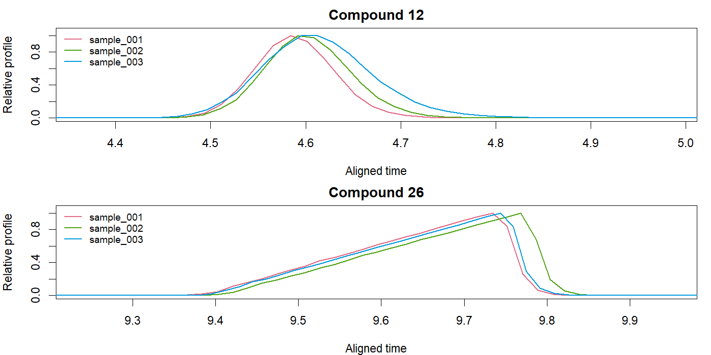
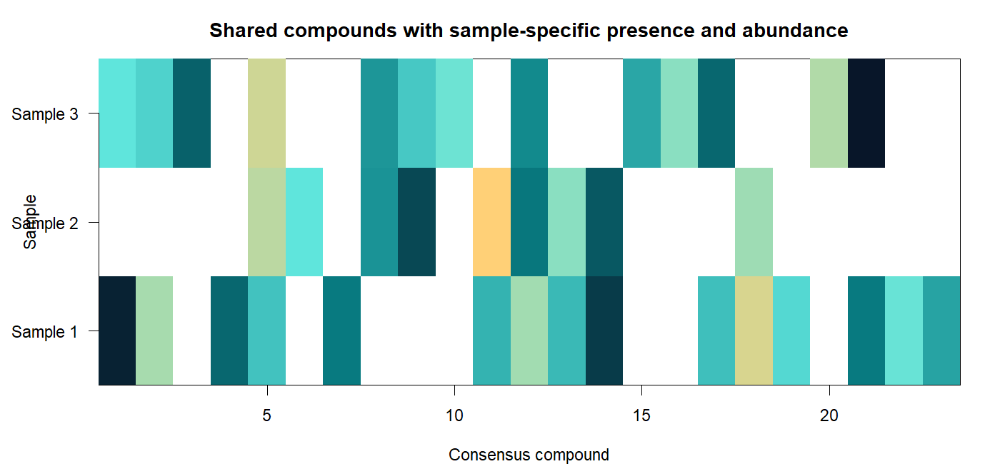
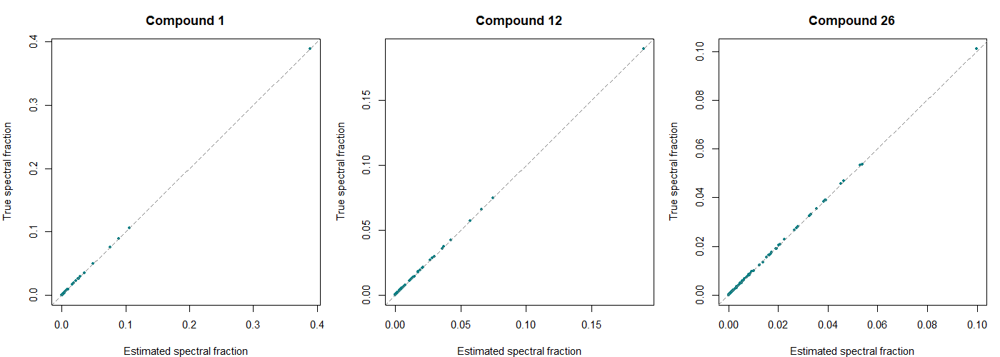

`coupledNMF()` combines related multichannel samples into a common spectral
library while fitting each sample's own compound areas, peak shapes and smooth
background. Samples retain their measured time grids. The model accommodates
retention-time drift, concentration-dependent widths and tails, and compounds
that occur in only some samples.

```r
fit <- coupledNMF(samples, family=quasipoisson("identity"), precluster=32L)
fit$areas                         # samples x consensus compounds
coef(fit, normalize="l1")          # common spectra
fitted(fit, sample=1L)             # original-grid fitted signal
sampleNMF(fit, sample=1L)          # standard per-sample NMF object
GIC(fit)
```

Each sample description contains `y`, `time`, and either a candidate PSF matrix
`X` or an independent `splogconNMF()` fit. Matrices can be supplied through RDS
paths. Observations, factors, weights and offsets are stored per sample, and
the optimization loop reads one sample at a time. Common spectra and compact
alignment summaries are shared in memory.

## Three samples, shared spectra and different peak shapes

The simulator provides exponentially modified Gaussian peaks, broad triangular
acid profiles, smooth backgrounds and irregular scan intervals. Peak width,
tailing and retention time can depend on concentration and position in the
chromatogram. `presence=0.5` makes compounds absent independently in half of the
samples on average.

```r
sim <- simulate_GCMS_samples(samples=3L, n=c(580L,600L,620L), k=26L,
  preset="time_area_acid", presence=0.5, seed=811)

samples <- lapply(sim$samples, function(s) list(
  y=s$Y, time=s$time, edges=s$edges, exposure=s$raw_exposure,
  sample_id=s$sample_id,
  X=convmatrix(dnorm(-8:8, sd=1.6), nrow(s$Y)),
  background=splines::bs(s$time, df=4L, intercept=TRUE)))

fit <- coupledNMF(samples, family=poisson("identity"), ncores=8L,
  control=list(initial=list(profile_cycles=4L, fusion_passes=2L)))
fit$areas
plot(fit, type="profiles", compounds=c(1L,12L))
```

The three-sample validation retains all **258 mass channels**. With every
compound present, it recovers **26 shared compounds and all 78 occurrences**.
With `presence=0.5`, the realized data contain **23 shared compounds and 37
occurrences**, all recovered. Missing occurrences remain `NA` in the area table.

| Simulation | True shared compounds | Recovered | True occurrences | Recovered | Total time |
|:--|--:|--:|--:|--:|--:|
| All compounds present | 26 | 26 | 78 | 78 | 29.69 s |
| 50% presence probability | 23 | 23 | 37 | 37 | 21.92 s |

These elapsed times include independent initialization, alignment, grouping and
coupled refinement on an eight-core Intel i9-11950H workstation. Both examples
include different scan grids and concentration-dependent peak shapes.





Shared spectra are estimated from all detected occurrences of a compound:



## Model on the original scan grids

For sample \(s\), let \(u=w_s(t)\) be its monotone alignment map. Native bin
edges \(t_{si-1/2},t_{si+1/2}\) define

\[
\Delta u_{si}=w_s(t_{si+1/2})-w_s(t_{si-1/2}),\qquad
J_{si}=\frac{\Delta u_{si}}{\Delta t_{si}}.
\]

With known exposure \(e_{si}>0\), the mean model is

\[
\mu_{sij}=e_{si}\left\{J_{si}\sum_g a_{sg}h_{sg}(u_{si})p_{gj}
 +(B_sA_s)_{ij}\right\}+o_{sij}.
\]

Spectra have \(p_{gj}\geq0\) and \(\sum_jp_{gj}=1\). Each detected profile
satisfies

\[
h_{sg}\geq0,\quad \sum_i\Delta u_{si}h_{sg}(u_{si})=1,\quad
\frac{\log h_{sg,i+1}-\log h_{sg,i}}{u_{s,i+1}-u_{si}}
\text{ is nonincreasing}.
\]

The Jacobian preserves integrated area under alignment. No interpolation or
resampling is applied to observations. Local likelihood evaluations use their
original channels, weights, offsets and sample-specific noise parameters.

The rank-selection objective is

\[
\mathcal J=-2\sum_{sij}w_{sij}\ell_s(y_{sij};\mu_{sij})
 +\kappa\lambda_{IC}\{(m-1)G+L+d_{\rm noise}\}.
\]

Here \(G\) is the number of common spectra and \(L\) the number of detected
sample-compound occurrences. A unit-sum spectrum contributes \(m-1\) free
coordinates and each occurrence contributes an amplitude. Profile and baseline
complexity are unpenalized shape-constrained nuisance terms in this rank
criterion. For temporal-correlation adjustment, \(\kappa\) is the largest
resolved sample information factor. Quasipoisson uses its frozen, scaled
Poisson kernel. The same `logLik()`, `AIC()`, `BIC()` and `GIC()` interfaces apply.

## Alignment and local updates

1. Fit samples independently, optionally initializing in 32 aggregated channel
   groups and returning to every original channel.
2. Match high-confidence spectra to a reference sample. Use the 1%-height peak
   start plus half the narrow-peak width as the timing anchor.
3. Fit a robust low-dimensional drift spline, with log area ratio as a nuisance
   term for concentration-related anchor motion. Retain its drift component
   and enforce positive slope.
4. Group spectra algebraically when their timing and area-ordered profile
   overlap are compatible. Each group has at most one occurrence per sample.
   This clustering stage performs no NMF or GLM refits.
5. Update local concave log profiles, pool spectral scores over samples, and
   update each smooth background. Backtrack against the original likelihood.
6. Retain a grouped fit when its complete penalized objective improves. Return
   temporally ordered consensus spectra and sample-specific areas.

For a common spectral coefficient \(p_{gj}\), with design value
\(x_{sgi}=e_{si}J_{si}a_{sg}h_{sg}(u_{si})\), the pooled negative-log-likelihood
score and Fisher information are

\[
U_{gj}=\sum_{si:g\in s}w_{sij}x_{sgi}g_{\mu,sij},\qquad
I_{gj}=\sum_{si:g\in s}w_{sij}x_{sgi}^{2}I_{\mu,sij}.
\]

A nonnegative scoring step is followed by full-likelihood backtracking.
Renormalizing a spectrum transfers its scale into the occurrence amplitudes
and preserves the fitted signal. Profile updates use the corresponding
chain-rule score in log coordinates and linear slope constraints on actual
aligned times. Native OpenMP updates give identical results across thread
counts in the validation examples.

The native spectral kernel evaluates each cell's likelihood derivatives once
and pools them over all sparse profiles in a single threaded pass. On a beer
chromatogram with 14,949 scans, 518 channels and 325 profiles, this reduced one
pooled-score calculation from **5.45 s to 0.19 s**, a **28.7-fold speedup**, while
matching the profile-wise calculation to numerical precision. Cached peak
geometry also avoids rescanning every profile after each algebraic merge.
Shared row-wise weights and offsets retain one vector throughout the coupled
fit, with channel-specific matrices used when required.

All seven [signal families](../reference/splogconNMF.html) are supported:
Gaussian, Poisson, quasipoisson, NB2, NB1, censored Gamma and common-scale Gamma.
Dispersion parameters are resolved from the original channels and frozen for
group comparisons. NB2 additionally supports likelihood-improving shape
updates when initialized with a negative `theta`.

## Exposure and GC/MS files

The default `exposure=1` models supplied intensities. When observations are
integrated ion counts, supply their known integration durations. The time
unit determines the unit of integrated areas; exposure specifies how the
underlying rate becomes an observed mean.

In quadrupole full-scan acquisition, effective per-mass acquisition time
depends on the mass range, step size, scan speed and scan averaging, as
described in the [Agilent acquisition documentation](https://openlab.help.agilent.com/en/mergedProjects/GCMSHelp/MEAcquiUI.htm).
ANDI files may store arbitrary abundance units alongside scan duration and
scan timing; see the [PyMassSpec ANDI implementation](https://pymassspec.readthedocs.io/en/master/_modules/pyms/GCMS/IO/ANDI.html).
The exported number of mass peaks therefore does not determine physical dwell
time. GCMSprime preserves vendor intensities and accepts explicit exposure
values when they are known.

For sample directories, alkane calibration and Excel/MSP exports, see
[Multisample GC/MS experiments](https://tomwenseleers.github.io/GCMSprime/articles/multisample.html).
The likelihood and constrained-factorization background is developed in
[Sparse log-concave NMF](log-concave-nmf.html).
