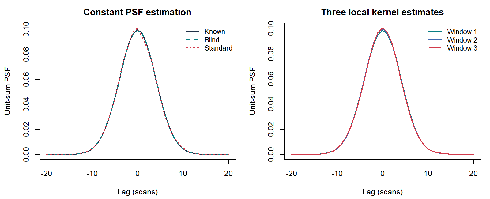

A short impulse is often recorded as a wider response: an optical blur, an
instrument response or a chromatographic peak. Its **point spread function
(PSF)** describes that response. With a known time-invariant PSF, shifted
copies form a convolution design matrix, and
[`L0glm.fit()`](https://tomwenseleers.github.io/L0glm/reference/L0glm.fit.html)
can estimate a sparse set of impulse locations and amplitudes directly.

When the PSF is unknown, two conditional problems can be alternated: estimate
the spike train given the kernel, then estimate the kernel given the spike
train. `estimate_psf()` combines this blind estimation with isolated-standard
calibration and windowed estimation of smoothly time-varying kernels.

## Deconvolve with a known, constant PSF

This multichannel signal has eight impulses, a common Gaussian response and
Poisson noise. Channels share impulse locations but have different amplitudes.

```r
library(L0glm)
library(L0nmf)
set.seed(611)
n <- 600L; m <- 6L
time <- seq_len(n) / 50
lag <- -20:20
g <- dnorm(lag, sd=4); g <- g/sum(g)
X <- convmatrix(g, n)
A <- matrix(0, n, m)
A[c(65,125,190,255,335,405,475,540),] <- runif(8L*m, 1500, 3500)
Y <- matrix(rpois(n*m, as.matrix(X %*% A)+3), n, m)

known <- L0glm.fit(X, Y, family=poisson("identity"), offset=3,
  nonnegative=TRUE, grouped=TRUE, relaxed=TRUE)
```

Selected rows in `coef(known)` locate the impulses. The
[fixed-PSF tutorial](https://tomwenseleers.github.io/L0glm/articles/deconvolution.html)
develops this regression model.

## Estimate an unknown kernel from overlapping signals

```r
blind <- estimate_psf(Y, time=time, family=poisson("identity"),
  standard=NULL, method="blind", nwindows=1L, precluster=1L,
  offset=3, control=list(L=41L, maxiter=4L))
blind$g_hat
blind$width_scans
```

`nwindows=1L` estimates one common PSF. The estimator starts with a positive
normalized kernel, alternates spike and kernel fits, and retains the completed
fit with the best requested information criterion. Unit-sum normalization
places scale in spike amplitudes; centroid alignment fixes the shift convention.

The default `precluster=1L` uses the total across channels. `FALSE` uses the
original channels; an integer requests at most that many intensity-adjusted
groups. The returned `blind$X` is a sparse scan-by-scan design ready for
`L0glm.fit()` or `splogconNMF()`.

## Calibrate from isolated standard peaks

```r
standard_spikes <- numeric(n)
standard_spikes[c(90,300,510)] <- c(12000,18000,15000)
standard <- list(Y=rpois(n, as.numeric(X %*% standard_spikes)+5), time=time)

calibrated <- estimate_psf(Y, time=time, standard=standard,
  family=poisson("identity"), method="standard", nwindows=1L,
  control=list(L=41L, baseline_df=4L, n_peaks=3L))
```

Calibration estimates a low-quantile background, identifies informative
isolated peaks and fits their log-concave profiles using the observation
likelihood. Normalized profiles are aligned by centroid and placed on the
sample scan interval. `method="standard"` retains this calibration;
`method="auto"` uses it to initialize blind refinement on the sample.



## Allow the PSF to vary through the signal

```r
varying <- estimate_psf(Y, time=time, standard=standard,
  family=poisson("identity"), method="auto", nwindows=3L,
  offset=3, control=list(L=41L, baseline_df=4L, n_peaks=3L, maxiter=4L))
varying$psf_timepoints
varying$psf_kernels
dim(varying$X)
```

Local kernels are estimated in overlapping windows and joined smoothly on
their log-profile scale. Each column of `varying$X` represents the response
appropriate to that impulse position. This synthetic signal has a constant
true kernel, so its local estimates should be similar; the same construction
captures gradual changes in instrumental response.

For an experimental example, bundled matrices include an alkane calibration
signal in `alkanes_TIC`, whose named time coordinate is recognized automatically:

```r
data(GCMS_data2)
psf <- estimate_psf(GCMS_data2, nwindows=3L, method="standard")
psf$method
psf$aggregation
```

Gaussian, Poisson, quasipoisson, NB2, NB1 and the two Gamma parameterizations
are supported with identity links. Noise scales are shared across channels.
Aggregation diagnostics record the variance matching used in reduced models.

A position-dependent PSF describes a common instrumental response. Components
whose shapes also depend on their identity or intensity can be modeled using
[sparse log-concave NMF](log-concave-nmf.html). The
[mathematical article](algorithm.html#psf-estimation) gives the objectives,
initialization and pseudocode. File-based calibration and automated reports
are available in
[GCMSprime](https://tomwenseleers.github.io/GCMSprime/articles/gcms-deconvolution.html).
