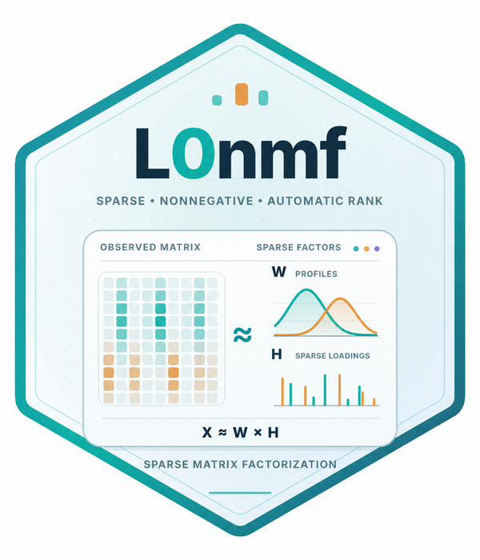

# L0nmf: Scalable Sparse Log-Concave Nonnegative Matrix Factorization with Automatic Rank Selection and Flexible Noise Models

<a href="https://tomwenseleers.github.io/L0nmf/">
<picture>
  <source media="(prefers-color-scheme: dark)" srcset="L0nmf/man/figures/logo-dark.svg">
  <source media="(prefers-color-scheme: light)" srcset="L0nmf/man/figures/logo-light.svg">
  
</picture>
</a>

[Get started](https://tomwenseleers.github.io/L0nmf/articles/log-concave-nmf.html) · [Documentation](https://tomwenseleers.github.io/L0nmf/reference/index.html) · [Algorithm & theory](https://tomwenseleers.github.io/L0nmf/articles/log-concave-nmf.html)

L0nmf is part of a focused three-package toolkit: [L0glm](https://tomwenseleers.github.io/L0glm/) supplies fast sparse GLM selection, [L0nmf](https://tomwenseleers.github.io/L0nmf/) supplies sparse factorization and PSF estimation, and [GCMSprime](https://tomwenseleers.github.io/GCMSprime/) turns those methods into a chromatographic GC/MS deconvolution workflow.

## Installation

```r
install.packages("remotes")
remotes::install_github("tomwenseleers/L0nmf/L0nmf")
```

## Recover profiles and spectra

```r
library(L0glm)
library(L0nmf)
data(GCMS_data1)
X <- convmatrix(convkernel("gaussian", 65L, list(sigma=8)), nrow(GCMS_data1))
fit <- splogconNMF(X, GCMS_data1, background=matrix(1,nrow(X),1),
                  family=quasipoisson("identity"), precluster=16L,
                  correlation="none")
fit
GIC(fit)
matplot(as.matrix(fit$H), type="l", lty=1, xlab="Scan", ylab="Elution profile")
```

The factors retain every original outcome channel. Profiles have unit area, nonnegative spectra carry their intensities, and a smooth unpenalized background captures baseline variation. Selection and fusion use a parsimonious rank criterion with local likelihood updates.

The final original-channel pass checks component deletions, local fusions and missed residual peaks, accepting each change only when the complete likelihood-and-compound criterion improves.

## Methods and applications

* [Sparse log-concave factorization and its mathematical model](https://tomwenseleers.github.io/L0nmf/articles/log-concave-nmf.html)
* [Constant and time-varying PSFs](https://tomwenseleers.github.io/L0nmf/reference/estimate_psf.html)
* [Blind deconvolution](https://tomwenseleers.github.io/L0nmf/reference/L0glm_blind_deco.html)
* [Simulated chromatograms](https://tomwenseleers.github.io/L0nmf/reference/simulate_GCMS.html)
* [GC/MS input, output and reports in GCMSprime](https://tomwenseleers.github.io/GCMSprime/articles/gcms-deconvolution.html)

Gaussian, Poisson, quasi-Poisson, negative-binomial and Gamma observation models are supported for identity-link nonnegative signals. The help pages describe aggregation, temporal dispersion, censored observations and the full objective.

`L0BestRankGNMF()` provides an experimental general factorization method. Its algorithm is being developed separately from the validated local log-concave workflow.

## Share spectra across samples

`coupledNMF()` aligns related samples and estimates common spectra with
sample-specific log-concave profiles, integrated areas and smooth backgrounds.
It supports all seven signal families, irregular scan grids and disk-backed
observations. In a three-sample simulation with all 258 channels, it recovers
all 78 compound occurrences in 29.69 seconds. With compounds absent from half
the samples, all 37 present occurrences are recovered in 21.92 seconds.

```r
fit <- coupledNMF(samples, family=quasipoisson("identity"), precluster=32L)
fit$areas
coef(fit, normalize="l1")
```

See [Coupled multisample factorization](https://tomwenseleers.github.io/L0nmf/articles/coupled-nmf.html) for simulations,
plots and mathematical details, and [GCMSprime](https://tomwenseleers.github.io/GCMSprime/articles/multisample.html)
for the directory-based chromatogram workflow.

## Citation

An article describing the methods implemented in L0nmf is in preparation.
If you use the package before the article is formally published, we would
appreciate a citation to the package:

Wenseleers T, Vanderaa C (2026).
*L0nmf: Scalable Sparse Log-Concave Nonnegative Matrix Factorization with Automatic Rank Selection and Flexible Noise Models*.
R package version 0.1.0,
<https://tomwenseleers.github.io/L0nmf/>.

The [Authors and Citation page](https://tomwenseleers.github.io/L0nmf/authors.html#citation) also provides the
citation in BibTeX format. Please also cite the methodological sources linked
in the help pages where relevant.

## Acknowledgements

OpenAI Codex, using GPT-6 Astra and GPT-6.1 Sol, was used to optimize and
refactor code and help draft the documentation. The key ideas and methodological
decisions are the authors' own, and the authors take full responsibility for the
work presented here.
